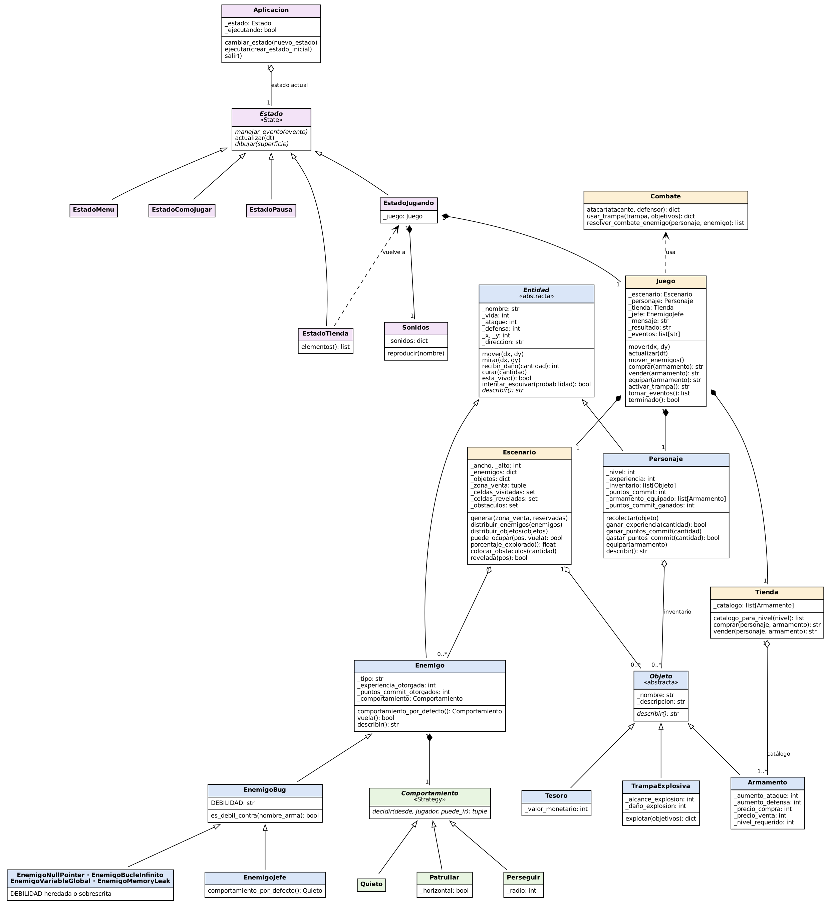

# Depuración: El Sueño del Programador

 

- ver [badgen](https://badgen.net/) o [shields](https://shields.io/) para otros tipos de _badges_

## Autor

- [@mastercelta](https://github.com/mastercelta)

## Descripción del Proyecto

Este proyecto consiste en el desarrollo de un videojuego básico utilizando los principios de la **Programación Orientada a Objetos** (POO). Los estudiantes crearán un mundo de juego interactivo donde los jugadores pueden controlar un personaje, explorar escenarios, interactuar con objetos y enemigos, y progresar a través de la historia. El juego se diseñará para enfatizar los conceptos de **POO**, como clases, objetos, herencia, polimorfismo y encapsulamiento. A través de este proyecto, los estudiantes aplicarán sus conocimientos de POO para construir un sistema modular y extensible, sentando las bases para proyectos de software más complejos en el futuro.

El proyecto se dividirá en varias fases, comenzando con la creación de clases para personajes, enemigos y objetos, y luego avanzando hacia la implementación de la lógica del juego, el sistema de combate y la interfaz de usuario básica. Se fomentará el uso de buenas prácticas de programación, como la documentación del código, el control de versiones con Git. Al finalizar el proyecto, los estudiantes habrán ganado experiencia práctica en el diseño y desarrollo de software orientado a objetos, así como en la resolución de problemas y el trabajo en equipo.

#### Objetivos del Proyecto

1.  Aplicar los principios de la programación orientada a objetos (POO), demostrando su capacidad para diseñar e implementar clases, objetos, herencia, polimorfismo y encapsulamiento en el contexto del desarrollo de un videojuego.
2.  Desarrollar un sistema modular y extensible, de manera que sea fácil de modificar y expandir, permitiendo la adición de nuevas funcionalidades y contenido en el futuro.
3.  Implementar la lógica del juego y el sistema de combate funcional y equilibrado, así como la lógica para la interacción con objetos y enemigos en el mundo del juego.
4.  Crear una interfaz de usuario básica que permita al jugador interactuar con el mundo del juego y visualizar la información relevante (puntos de vida, inventario, etc.).
5.  Practicar buenas prácticas de programación como el control de versiones (Git), documentar su código.

## Historia y mundo del juego

Eres un estudiante de primer semestre que se quedó dormido estudiando para el parcial de programación. En el sueño, el código que escribiste a las 3 a. m. cobra vida: cada error se convirtió en un enemigo y el programa entero es un mundo roto que debes recorrer y depurar antes de que suene el despertador.

El mundo sigue la estructura de un Zelda clásico, con vista superior: un **Escritorio** central (el hub) conecta con cuatro zonas. Cada zona enseña un concepto de programación, lo convierte en una mecánica de juego y entrega una **herramienta** que abre la puerta de la siguiente.

| Zona | Concepto | Desafío de la zona | Minijuego | Herramienta que entrega |
|:---|:---|:---|:---|:---|
| 1. Valle de las Variables | variables y tipos de datos | Altares que piden un tipo: hay que llevar el ítem correcto (número, texto, booleano) | Memoria de tipos: parejas valor ↔ tipo (`42`↔`int`, `"hola"`↔`str`, `True`↔`bool`) | Declarador |
| 2. Bosque de los Condicionales | `if` / `else`, `and` / `or` | Puertas con una condición visible (`if llave and nivel >= 2`) y caminos que se bifurcan según lo que se cumpla | Verdadero o falso: evaluar expresiones (`5 > 3 and not False`) contra reloj | Detector de condiciones |
| 3. Laberinto de los Bucles | `while` / `for`, condición de parada | El Bucle Infinito se clona hasta que el jugador cumple la condición de parada en una palanca | Secuencia: predecir qué imprime un `for` (`range(0, 10, 3)` → `0 3 6 9`) | Break |
| 4. Castillo de los Objetos | clases, herencia, polimorfismo | Familias de enemigos: la subclase hereda la debilidad del padre o la sobrescribe. Jefe final: **El Legacy Code** | Clasificar: ubicar cada enemigo bajo su clase padre según su debilidad | Refactorizador |

**Economía con significado**

- **Experiencia (XP)**: mide comprensión. Se gana al resolver los desafíos y minijuegos de cada zona (y en menor medida en combate). Cada zona entrega el XP necesario para alcanzar el nivel que exige la siguiente.
- **Commits**: miden calidad. Vencer a un bug con su herramienta correcta (su debilidad) vale 3 commits; vencerlo a golpes vale 1. Se gastan en la tienda y para "aprobar el pull request" que abre la puerta de la siguiente zona.
- **Bestiario**: cada bug derrotado se registra con una línea del concepto que representa.

## Requerimientos

* **R1.1. Creación de Personaje Jugable**: El sistema debe permitir la creación de un personaje jugable con los siguientes atributos: Puntos de vida, Ataque, Defensa, Nivel, Inventario.

* **R1.2. Creación de Enemigos**: El sistema debe permitir la creación de enemigos con los siguientes atributos: Puntos de vida, Ataque, Defensa, Tipo ("volador", "terrestre").

* **R2.1. Creación de Trampas Explosivas**: El sistema debe permitir la creación de trampas explosivas con atributos de: Alcance de explosión, Daño por explosión.

* **R2.2. Creación de Tesoros**: El sistema debe permitir la creación de tesoros con un atributo de: Valor monetario.

* **R2.3. Creación de Armamento/Defensa**: El sistema debe permitir la creación de objetos de armamento y defensa con atributos de: Aumento de ataque/defensa, Precio de compra/venta.

* **R3.1. Interacción de Combate**: El personaje debe poder atacar y defenderse de los enemigos.

* **R3.2. Recolección de Objetos**: El personaje debe poder recolectar trampas explosivas y tesoros.

* **R3.3. Interacción con Armamento/Defensa**: El personaje debe poder comprar, usar y vender objetos de armamento y defensa.

* **R3.4. Interacción con el Entorno**: El personaje debe poder recolectar objetos y esquivar obstáculos dentro del escenario.

* **R4.1. Generación del Escenario**: El sistema debe generar un escenario desconocido con diferentes áreas explorables.

* **R4.2. Distribución de Elementos**: El sistema debe ubicar aleatoriamente enemigos y objetos dentro del escenario.

* **R4.3. Zonas de Venta**: El sistema debe incluir zonas de venta donde el personaje pueda comprar armamento y mejoras.

* **R5.1. Mecánica de Combate**: El sistema debe implementar un sistema de combate que permita el ataque y la defensa entre el personaje y los enemigos.

* **R5.2. Cálculo de Daño**: El sistema debe calcular el daño infligido en base a los atributos de ataque, defensa y puntos de vida.

* **R5.3. Efectos Especiales**: El sistema debe generar efectos especiales basados en el tipo de ataque y la interacción entre objetos (ej: explosión de trampas).

* **R6.1. Sistema de Experiencia y Nivel**: El personaje debe ganar experiencia al derrotar enemigos y recolectar objetos valiosos, lo que lleva al aumento de nivel.

* **R6.2. Mejora de Atributos**: El sistema debe permitir la mejora de los atributos del personaje (puntos de vida, ataque, defensa) al subir de nivel.

* **R6.3. Acceso a Nuevo Equipamiento**: El sistema debe permitir el acceso a nuevo armamento y defensas a medida que el personaje avanza de nivel.

* **R7.1. Victoria por Exploración**: El juego debe tener una condición de victoria al completar la exploración del mapa del juego.

* **R7.2. Victoria por Combate Final**: El juego debe tener una condición de victoria al derrotar a un jefe final.

* **R7.3. Victoria por Puntaje:**: El juego debe tener una condición de victoria al alcanzar un puntaje determinado.

* **R8.1. Interfaz de Usuario (UI)**: sistema debe proporcionar una interfaz de usuario intuitiva y fácil de usar que muestre información relevante al jugador (puntos de vida, inventario, nivel, etc.).

* **R8.2. Retroalimentación del Jugador**: El sistema debe proporcionar retroalimentación visual y auditiva clara para las acciones del jugador (ej: daño recibido, recolección de objetos, etc.).

#### Requerimientos propios del juego

Estos requerimientos amplían los anteriores con la historia y el mundo descritos arriba.

* **R9.1. Pantalla principal**: El juego debe iniciar en un menú con las opciones Nueva partida, Cómo jugar y Salir, navegable con teclado.

* **R9.2. Estados del juego**: El sistema debe manejar al menos los estados menú, jugando, minijuego, pausa y fin de partida (victoria o derrota), con transiciones claras entre ellos.

* **R10.1. Movimiento fluido**: El personaje debe moverse de forma continua en cuatro direcciones y orientarse hacia la dirección de movimiento.

* **R10.2. Enemigos con comportamiento**: Los enemigos deben patrullar o perseguir al jugador según su tipo; los voladores ignoran obstáculos y los terrestres no.

* **R11.1. Mundo por zonas**: El mundo debe tener un hub (Escritorio) y cuatro zonas temáticas, cada una asociada a un concepto de programación.

* **R11.2. Puertas con requisito**: Cada zona debe abrirse solo cuando el jugador tiene la herramienta de la zona anterior y el nivel requerido.

* **R11.3. Herramientas**: Cada zona debe entregar una herramienta (Declarador, Detector de condiciones, Break, Refactorizador) que además funciona como armamento con debilidad asociada.

* **R12.1. Desafío de zona**: Cada zona debe tener al menos un desafío jugable que aplique su concepto (altares de tipos, puertas condicionales, bucle con condición de parada, familias de enemigos).

* **R12.2. Minijuego de zona**: Cada zona debe tener un minijuego educativo (memoria de tipos, verdadero/falso, secuencia de bucle, clasificación de clases) que otorgue experiencia y la herramienta de la zona.

* **R12.3. Código en pantalla**: Cada desafío debe mostrar el fragmento de código que representa, para que la acción del jugador se relacione con el concepto.

* **R13.1. Valor de la experiencia**: La experiencia debe ganarse principalmente al resolver desafíos y minijuegos, y cada zona debe entregar la suficiente para alcanzar el nivel que exige la siguiente.

* **R13.2. Valor de los commits**: Vencer a un enemigo con su debilidad debe valer más commits que vencerlo sin ella, y los commits deben gastarse en la tienda y en abrir zonas.

* **R13.3. Bestiario**: Cada enemigo derrotado por primera vez debe registrarse con el concepto que representa y poder consultarse desde el juego.

#### Opcionales

* **O1. Niveles de Dificultad**: El juego debe permitir la selección de diferentes niveles de dificultad, que afecten a los atributos de los enemigos, la cantidad de objetos y la complejidad del escenario.

* **O2. Gráficos**: El sistema debe utilizar gráficos de alta calidad que sean consistentes con el estilo visual del juego.

* **O3. Efectos de Sonido**: El sistema debe incluir efectos de sonido para las acciones del jugador, los enemigos y el entorno.

* **O4. Sistema de Logros/Desafíos**: El sistema debe incluir un sistema de logros o desafíos para recompensar al jugador por completar tareas específicas.

* **O5. Música de Fondo**: El sistema debe incluir música de fondo que se adapte al ambiente y la acción del juego.

* **O6. Tutorial**: El sistema debe incluir un tutorial interactivo para enseñar a los nuevos jugadores las mecánicas básicas del juego.

* **O7. Ayuda**: El sistema debe proporcionar un sistema de ayuda contextual que explique las funcionalidades y objetos del juego.

* **O8. Sistema de Personalización**: El sistema debe permitir la personalización del personaje, ya sea cambio de vestimenta, o de armas.

* **O9. Multijugador**: Incluir opciones multijugador, se deben definir los modos de juego, la cantidad de jugadores y la comunicación entre ellos.

#### Glosario

- Puntos de vida: Representa la resistencia del personaje/enemigo al daño.
- Ataque: Define el poder de ataque del personaje/enemigo.
- Defensa: Representa la capacidad del personaje/enemigo para resistir el daño.
- Nivel: Indica el progreso del personaje y habilita nuevas habilidades.
- Inventario: Almacena los objetos que el personaje recolecta.
- Tipo: Puede variar según el comportamiento o habilidades del enemigo (ej: volador, terrestre, etc.).
- Trampas explosivas: Deben tener diferentes alcances y efectos negativos sobre el personaje.
- Tesoros: Deben tener diferentes objetos valiosos que se traduzcan en dinero para el personaje al venderlos.
- Armamento/Defensa: El personaje debe poder comprar/vender para mejorar su ataque/defensa.

## Diseño

#### Conceptos de POO aplicados

| Concepto | Dónde se aplica |
|:---|:---|
| Abstracción | `Entidad`, `Objeto`, `Estado` y `Comportamiento` son clases abstractas (`ABC`) que no se pueden instanciar |
| Encapsulación | Atributos privados (`_vida`, `_inventario`, ...) expuestos con `@property` y setters con validación |
| Herencia | `Entidad → Enemigo → EnemigoBug → NullPointer, BucleInfinito, VariableGlobal, MemoryLeak, Jefe` |
| Polimorfismo | `describir()`, `es_debil_contra()`, `comportamiento_por_defecto()` y los métodos de cada `Estado` cambian según la clase |
| Composición | `Juego` tiene un `Escenario`, un `Personaje` y una `Tienda`; cada `Enemigo` tiene un `Comportamiento` |

#### Patrones de diseño

- **State** (`ui/estados/`): cada pantalla (menú, cómo jugar, jugando, pausa) es una subclase de `Estado`. La `Aplicacion` solo le delega eventos, actualización y dibujo, sin saber en qué pantalla está.
- **Strategy** (`models/comportamiento.py`): cada enemigo tiene un `Comportamiento` intercambiable (`Patrullar`, `Perseguir`, `Quieto`). Los terrestres patrullan, los voladores persiguen y el jefe sobrescribe `comportamiento_por_defecto()` para quedarse quieto.

#### Diagrama de clases



## Instalación

1. Clonar el proyecto

    ```bash
    git clone https://github.com/mastercelta/lpa1-taller-videojuegos.git
    cd lpa1-taller-videojuegos
    ```

2. Crear y activar entorno virtual

    ```bash
    python3 -m venv venv
    source venv/bin/activate
    ```

3. Instalar librerías y dependencias

    ```bash
    pip install -r requirements.txt
    ```
    
## Ejecución

1. Ejecutar el proyecto

    ```bash
    cd lpa1-taller-videojuegos
    python3 main.py
    ```

2. Controles

    | Tecla | Acción |
    |:---|:---|
    | Flechas | Mover al personaje (mantener presionada para caminar seguido) / navegar menús |
    | Enter | Confirmar en menús; volver al menú al terminar la partida |
    | R | Reiniciar la partida al terminar |
    | ESC | Pausa durante la partida; volver o salir en los menús |

3. Ejecutar las pruebas

    ```bash
    python3 -m pytest tests/ -v
    ```

